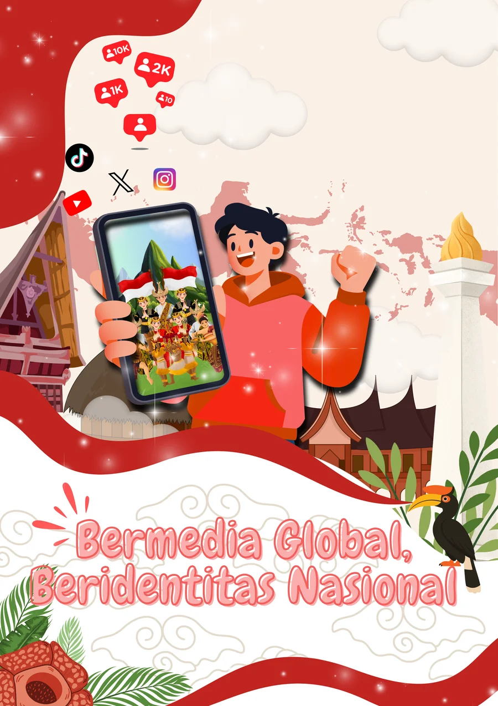

<div align="center">

# 🇮🇩 Bermedia Global, Beridentitas Nasional
### *Dinamika Media Sosial dan Identitas Nasional Generasi Muda Indonesia*

[](https://vercel.com/new)
[](LICENSE)
[](https://developer.mozilla.org/en-US/docs/Web/HTML)
[](https://developer.mozilla.org/en-US/docs/Web/CSS)
[](https://developer.mozilla.org/en-US/docs/Web/JavaScript)
[](https://www.chartjs.org/)
[]()

<p align="center">
  <strong>Platform Pembelajaran Interaktif & Portal Data Empiris Pendidikan Pancasila dan Kewarganegaraan (PPKn)</strong><br>
  Mengkaji benturan antara arus globalisasi media digital dan ketahanan identitas nasional pemuda Indonesia berbasis sintesis 30+ riset akademik multikampus & survei primer (N=44).
</p>

[🌐 Demo Langsung](#-panduan-deployment-vercel) • [📖 Modul Pelajaran](#-struktur-kurikulum-5-modul-ppkn) • [📊 Data Riset](#-sintesis-data-riset-empiris-multikampus) • [🎯 Dashboard Survei](#-dashboard-survei-mahasiswa-n44) • [🧠 Kuis Interaktif](#-kuis-interaktif-evaluasi-belajar)

---



</div>

<br>

## 📌 Ringkasan Eksekutif

Di era konvergensi digital, media sosial bukan lagi sekadar instrumen komunikasi, melainkan arena utama pembentukan konsep diri, gaya hidup, dan orientasi nilai generasi muda. Platform ini dirancang sebagai media edukasi berbasis bukti (*evidence-based educational platform*) untuk mata kuliah **Pendidikan Pancasila dan Kewarganegaraan (PPKn)** Kelompok 3 (2026).

Platform ini menyajikan integrasi utuh antara:
1. **Kurikulum Tematik**: 5 Modul pembelajaran mendalam berlandaskan teori sosiologi komunikasi kritis.
2. **Kompilasi Data Empiris**: Komparasi data statistik dari 7 perguruan tinggi terkemuka di Indonesia.
3. **Dataset Survei Lapangan Primer**: Visualisasi 8 parameter analitik dari 44 responden mahasiswa/pelajar dengan filter data dinamis.
4. **Evaluasi Formatif**: Kuis interaktif 8 butir soal dengan pembahasan langsung dan penilaian berbasis CPMK.
5. **Rujukan Ilmiah**: 31 daftar pustaka akademik berstandar APA 7th Edition.

---

## 🎨 Filosofi Desain: *Warm Nusantara Editorial*

Berbeda dari antarmuka modern yang sarat nuansa *cyberpunk/futuristic* neon gelap yang dingin, platform ini mengadopsi bahasa visual **Poster Fisik Kebangsaan**:

- **Latar Belakang**: *Warm Cream / Broken White* (`#FAF7F2`) dengan tekstur matriks kertas fisik yang nyaman untuk membaca lama (*reading-friendly*).
- **Palet Warna Utama**:
  - 🔴 **Merah Crimson Nasional** (`#DC2626` / `#C02626`): Melambangkan keberanian, ketegasan identitas, dan aksen kebangsaan.
  - ⚪ **Putih Bersih** (`#FFFFFF`): Memberikan ruang kontainer kartu yang tajam dan kontras.
  - 🟡 **Emas Monas** (`#D97706` / `#F59E0B`): Merepresentasikan keagungan peradaban dan optimisme generasi emas 2045.
  - 🟢 **Hijau Tropis** (`#16A34A`): Menggambarkan kearifan lokal, kesuburan kepulauan, dan ketenangan berpikir.
  - ⚫ **Dark Charcoal Text** (`#1A1A1D`): Tipografi tajam berketerbacaan tinggi berstandar aksesibilitas WCAG AAA.
- **Tipografi**: *Plus Jakarta Sans* untuk keterbacaan artikel editorial akademik yang rapi dan elegan.
- **Komponen**: Card *rounded-2xl* dengan aksen pita merah atas, *pill badges*, dan *reading progress bar* dinamis.

---

## 📚 Struktur Kurikulum 5 Modul PPKn

Platform ini membagi materi pembelajaran ke dalam 5 modul modular mandiri:

| Modul | Topik Pembelajaran | Fokus Konseptual &amp; Teori | Estimasi Waktu |
| :---: | :--- | :--- | :---: |
| **01** | **Media Sosial &amp; Identitas Diri** | Dramaturgi *Front vs Back Stage* Erving Goffman (1959), fabrikasi visual, respons emosional (63.3%), dan defisit kepercayaan diri (52.2%). | ~10 Menit |
| **02** | **Identitas Sosial vs. Identitas Nasional** ⭐ | *Social Identity Theory* Tajfel &amp; Turner (1979), asimetri validasi instan vs narasi kebangsaan abstrak, pengaruh kreator (R²=25.3%), paradoks 92% sadar vs 22.2% konsumsi rutin. | ~15 Menit |
| **03** | **Budaya Global &amp; Ketahanan Budaya** | Penetrasi budaya pop global, simulakra Baudrillard (1981), temuan FKIP HKBP Nommensen (37% suplai budaya asing), dan konsep identitas hibrida. | ~12 Menit |
| **04** | **Kebebasan Berekspresi &amp; Etika Digital** | Ruang publik digital Habermas (1989), *filter bubble &amp; echo chamber* Eli Pariser (2011), netiket, dan penegakan hukum UU ITE No. 1/2024. | ~12 Menit |
| **05** | **Peran Pemuda &amp; Tri-Level Roadmap** | Gerakan *Digital Mindfulness* (<3 jam/hari), mitigasi konsumsi hedonis (R²=88.8%), dan *Tri-Level Policy Roadmap* (Mikro, Meso, Makro). | ~15 Menit |

---

## 📊 Sintesis Data Riset Empiris Multikampus

Seluruh argumentasi didukung data statistik faktual yang diekstraksi dari laporan riset ilmiah:

```
                  PENGARUH MEDIA SOSIAL PADA MAHASISWA INDONESIA
┌───────────────────────────────────────┬────────────┬─────────────────────────────┐
│ Perguruan Tinggi / Peneliti           │ Parameter  │ Variabel / Temuan Utama     │
├───────────────────────────────────────┼────────────┼─────────────────────────────┤
│ Universitas Tarumanagara (UNTAR)      │ R² = 88.8% │ Gaya Hidup Hedonis          │
│ Univ. Mercu Buana Jakarta (UMB)       │ R² = 63.9% │ Perilaku Konsumtif Fashion  │
│ UIN Sultan Syarif Kasim Riau          │ R² = 49.9% │ Perilaku Konsumtif Belanja  │
│ Univ. Negeri Manado (UNIMA)           │ F = 43.318 │ Pembentukan Karakter PPKn   │
│ Univ. HKBP Nommensen Medan            │ 37.0%      │ Dominasi Paparan Asing      │
│ UIN Sunan Gunung Djati Bandung        │ R² = 25.3% │ Pengaruh Influencer Medsos  │
│ FKIK Univ. Jambi (UNJA)               │ 73.0%      │ Tingkat Adiksi Medsos Berat │
└───────────────────────────────────────┴────────────┴─────────────────────────────┘
```

---

## 📈 Dashboard Survei Mahasiswa (N=44)

Modul dashboard (`survei.html`) memuat analitik interaktif berbasis Chart.js dengan dataset primer:
- **Sebaran Platform**: TikTok (43.2%), Instagram (36.4%), YouTube (13.6%), WhatsApp (6.8%).
- **Intensitas Penggunaan**: 40.7% responden menggunakan media sosial >6 jam/hari; 52.3% membuka aplikasi sangat sering sepanjang waktu.
- **Asimetri Sikap vs Tindakan**: 92.0% memandang identitas nasional sangat krusial, namun konsumsi harian didominasi produk budaya global.
- **Tabel Eksplorasi Data Mentah**: Fitur live search instan untuk menelusuri data 44 responden secara real-time.

---

## 🧠 Kuis Interaktif Evaluasi Belajar

Fitur evaluasi formatif mandiri (`kuis.html`) dilengkapi:
- **8 Butir Soal Konseptual &amp; Kasus**: Menguji penguasaan materi sosiologi, interpretasi data empiris, dan etika Pancasila.
- **Feedback &amp; Pembahasan Instan**: Penjelasan akademik langsung muncul setelah pengguna memilih jawaban.
- **Kalkulasi Skor Real-Time**: Evaluasi berbasis CPMK dengan kategori kelulusan (*Mastery*, *Competent*, atau *Review*).

---

## 🗂️ Struktur Direktori Repositori

```
ppkn-kel-3/
├── index.html                  # Portal Beranda Utama (Hero Showcase, KPI, Modul Overview)
├── riset.html                  # Database Komparasi Empiris 7 Kampus & Matriks Risiko 5.1
├── survei.html                 # Dashboard Visualisasi 8 Chart.js Dataset Survei (N=44)
├── teori.html                  # Ensiklopedia 5 Kerangka Teori Sosiologi & Komunikasi
├── kuis.html                   # Antarmuka Kuis Evaluasi PPKn Interaktif (8 Soal + Review)
├── pustaka.html                # 31 Daftar Pustaka Akademik Lengkap Format APA 7th Edition
├── favicon.svg                 # Ikon Favicon Bendera Merah Putih
├── vercel.json                 # Konfigurasi Routing Clean URLs & Security Headers Vercel
├── manifest.json               # Konfigurasi PWA Web App Manifest
│
├── materi/
│   ├── index.html              # Hub Silabus & Katalog 5 Modul Pembelajaran
│   ├── modul-1.html            # Modul 1: Media Sosial & Identitas Diri (Goffman)
│   ├── modul-2.html            # Modul 2: Asimetri Identitas Sosial vs Nasional (Tajfel)
│   ├── modul-3.html            # Modul 3: Budaya Global & Identitas Nasional (Baudrillard)
│   ├── modul-4.html            # Modul 4: Kebebasan Berekspresi & Tanggung Jawab (Habermas)
│   └── modul-5.html            # Modul 5: Peran Pemuda & Tri-Level Policy Roadmap
│
├── css/
│   ├── main.css                # Design System Global, Token Warna, Navbar, Footer, Tables
│   └── modules.css             # Layout Modul, Reading Progress, Callouts, Quiz Styling
│
├── js/
│   ├── main.js                 # Navigasi Responsif, Smooth Scroll, Animated Counters
│   ├── charts.js               # Dataset Survei N=44, Chart.js Visuals, Live Search Table
│   └── quiz.js                 # Engine Kuis Interaktif, State Scoring & Penjelasan
│
└── assets/
    ├── poster.webp             # Gambar WebP Teroptimasi Poster Resmi Kelompok 3
    ├── hero_illustration.webp  # Ilustrasi Vektor Pendukung
    └── poster.png              # Aset Grafis Cadangan High-Resolution
```

---

## 🚀 Panduan Deployment & Menjalankan Lokal

Platform ini dibangun dengan arsitektur **Zero-Dependency Static Multi-Page Web App** sehingga dapat dijalankan tanpa langkah kompilasi yang rumit.

### 1. Menjalankan di Komputer Lokal

Cukup kloning repositori dan buka file `index.html` menggunakan peramban web modern, atau gunakan server HTTP lokal:

```bash
# Kloning repositori
git clone https://github.com/luciferKERO/ppkn-kel-3.git
cd ppkn-kel-3

# Jalankan server lokal sederhana (Python)
python -m http.server 8000

# Buka pada browser di http://localhost:8000
```

### 2. Deploy Instan ke Vercel

Repositori telah dilengkapi file `vercel.json` dengan konfigurasi `cleanUrls: true`.

#### Cara A: Melalui Dashboard Vercel (Rekomendasi)
1. Buka [vercel.com](https://vercel.com) dan masuk ke akun Anda.
2. Klik **Add New Project** → **Import Git Repository**.
3. Pilih repositori `luciferKERO/ppkn-kel-3`.
4. Biarkan pengaturan default (Framework: *Other*, Root Directory: `./`).
5. Klik **Deploy**. Website akan langsung aktif dalam hitungan detik!

#### Cara B: Menggunakan Vercel CLI
```bash
# Install Vercel CLI global (jika belum)
npm i -g vercel

# Login dan deploy
vercel
```

---

## 📖 Rujukan & Landasan Ilmiah

Materi dan instrumen dalam platform ini berlandaskan pada 31 karya ilmiah akademik terakreditasi, antara lain:
1. **Alvina & Loisa, R. (2021).** Pengaruh Penggunaan Media Sosial terhadap Gaya Hidup Hedonis Mahasiswa. *Koneksi*, 5(2), 296–303.
2. **Baudrillard, J. (1981).** *Simulacres et Simulation*. Paris: Éditions Galilée.
3. **Goffman, E. (1959).** *The Presentation of Self in Everyday Life*. New York: Anchor Books.
4. **Hanifah, N. (2025).** Pengaruh Influencer Media Sosial terhadap Pembentukan Identitas Sosial Mahasiswa. *Jurnal Komunikasi Penyiaran Islam UIN SGD*, 13(1), 77–92.
5. **Nadeak, R., dkk. (2025).** Analisis Pengaruh Media Sosial terhadap Identitas Nasional Mahasiswa. *Jurnal Pendidikan Kewarganegaraan*, 9(1), 40–56.
6. **Tajfel, H., & Turner, J. C. (1979).** An Integrative Theory of Intergroup Conflict. *The Social Psychology of Intergroup Relations*, 33–47.
*(Daftar lengkap 31 referensi tersedia di halaman `pustaka.html`)*

---

## 👥 Tim Penyusun & Kontributor

- **Mata Kuliah**: Pendidikan Pancasila dan Kewarganegaraan (PPKn)
- **Kelompok**: Kelompok 3 (Tahun Akademik 2026)
- **Topik Kajian**: *Bermedia Global, Beridentitas Nasional*
- **Maintainer**: [@luciferKERO](https://github.com/luciferKERO)

---

## 📄 Lisensi

Proyek ini dirilis di bawah lisensi [MIT License](LICENSE). Bebas digunakan, dimodifikasi, dan didistribusikan untuk keperluan edukasi, riset akademik, dan kemajuan literasi kewarganegaraan digital Indonesia.

<div align="center">
  <sub>Dibuat dengan dedikasi untuk Generasi Muda Indonesia yang Berwawasan Global dan Berakar Kuat pada Nilai-Nilai Luhur Pancasila. 🇮🇩</sub>
</div>
